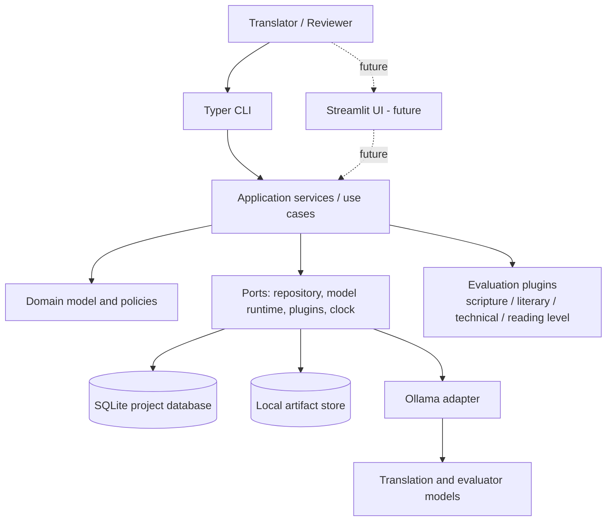
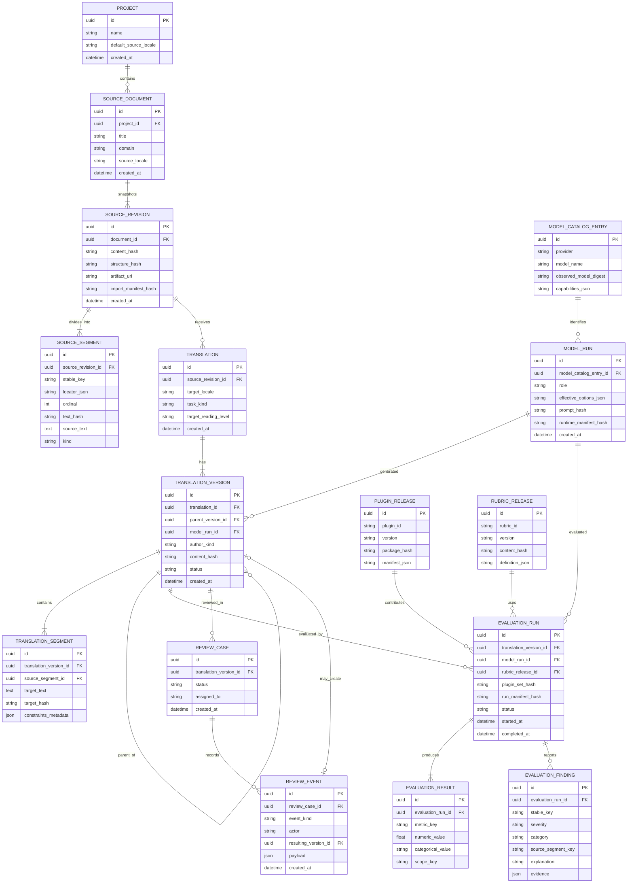

# Local First AI Translation and Evaluation Platform

## Scope and architecture decisions

This design covers a Python 3.15 application with a Typer CLI, SQLite persistence through SQLAlchemy, and Ollama as the initial local model runtime. Streamlit is a later presentation layer and must call the same application services as the CLI. The system handles translation and reading-level adaptation across scripture, literary, and technical material.

The central rule is that **source material is immutable and every derived result is an append-only, attributable artifact**. Editing, translating, evaluating, or reviewing never overwrites prior content. A new artifact records its parent and the inputs that produced it. This gives users a dependable audit trail and supports comparisons, rollback, and replay.

Key decisions:

| Decision | Rationale |
|---|---|
| Store source revisions as immutable snapshots | Reproducible work must point to the exact text and segmentation used, even after imports or metadata changes. |
| Persist translations and reviews as immutable versions/events | Human edits must not erase model output; competing model results remain comparable. |
| Keep evaluation runs separate from translation versions | A translation can be evaluated repeatedly with different evaluator models, rubrics, and plugin versions. |
| Make task intent explicit | Translation, transliteration if added later, and reading-level simplification have different constraints and evaluation criteria. |
| Use domain plugins at evaluation boundaries | Scripture, fiction, and technical checks can evolve independently without embedding their rules into the core workflow. |
| Record resolved configuration and content hashes | Model tags and prompts can change; recording effective values makes a run auditable and replayable. |
| Use SQLite as a local project store | It is simple to back up and portable. WAL mode and short transactions support the expected single-user workflow; SQLite is not the multi-writer server tier. |

## 1. High level architecture



The domain and application layers do not depend on Typer, Streamlit, SQLAlchemy, or Ollama. Adapters implement the ports. The database stores searchable structured data and audit metadata; the local artifact store holds large import/export payloads and optional exact prompt/response captures. Artifacts are addressed by content hash, and records refer to those hashes.

## 2. Module layout

```text
src/ai_translator/
  domain/
    projects.py              # project and locale value objects
    sources.py               # immutable source snapshot and segment identity
    tasks.py                 # translation vs simplification intent and constraints
    translations.py          # translation version and segment outputs
    evaluations.py           # evaluation run, findings, scores
    reviews.py               # review assignments, decisions, comments, edit lineage
    provenance.py            # run manifest, hashes, actor and timestamp concepts
    errors.py
  application/
    commands/                # import, translate, evaluate, review, compare, export
    queries/                 # list versions, inspect findings, review queue
    ports.py                 # repository, runtime, plugin registry, artifact store
    services/                # orchestration and transaction boundaries
  infrastructure/
    persistence/
      sqlalchemy/            # ORM mappings, repositories, migrations
    ollama/                  # model discovery, generation, health and version capture
    artifacts/               # content-addressed local payload storage
    plugins/                 # plugin discovery, registration and compatibility checks
    settings.py              # paths and local configuration
  interfaces/
    cli/                     # Typer commands; input/output only
    streamlit/               # future UI; calls application services only
  plugins/
    core/                    # generic fidelity, completeness, consistency checks
    scripture/               # scripture-specific checks
    literary/                # voice, style, dialogue and narrative checks
    technical/               # terminology, units, tables and formatting checks
    readability/             # target-level and simplification checks
  resources/
    rubrics/                 # versioned built-in rubric definitions
    prompts/                 # versioned prompt templates
```

Keep `domain` free of persistence and runtime imports. The ORM mapping should be an infrastructure concern; domain records can be mapped to/from ORM entities in repositories. Plugin packages register capabilities through a stable manifest and interface, not by reaching into application internals.

## 3. Database ERD



`SOURCE_SEGMENT.source_text` is a convenient searchable copy of the immutable snapshot payload. The canonical snapshot artifact is also content addressed. Once a `SOURCE_REVISION` is committed, its text, segment membership, and structure are immutable; corrected imports create a new revision. A document may therefore have a new source revision without changing the history of translations based on the earlier revision.

## 4. SQLAlchemy entity design

Use SQLAlchemy 2.x declarative mappings and UUID primary keys. Persist timestamps in UTC. Use foreign keys, explicit uniqueness constraints, and SQLite foreign key enforcement. Store stable, queryable attributes in columns and variable plugin/model payloads in JSON columns (serialized as canonical JSON for hashing). Keep ORM entities in the persistence adapter; expose immutable domain values to application services.

Recommended constraints and indexes:

- Unique `(document_id, content_hash)` on source revisions; unique `(source_revision_id, stable_key)` on source segments.
- Unique `(translation_id, version_sequence)` or a monotonic sequence allocated transactionally; unique `(translation_version_id, source_segment_id)` on outputs.
- Unique `(evaluation_run_id, metric_key, scope_key)` for scalar results; findings use run-local stable keys.
- Index source revision, target locale, task kind, model, status, created time, and review queue status for common queries.
- Foreign keys use restrictive deletes for historical records. Deleting a project should be an explicit archive/export workflow, not cascading destruction.
- Add SQLAlchemy event guards and service-level checks against updates/deletes of immutable rows; append-only behavior is a domain invariant, not a UI convention.

Use a `Translation` aggregate to group the task for one source snapshot, target locale, and task configuration. Each `TranslationVersion` is a complete snapshot, not a mutable delta. Version lineage (`parent_version_id`) links model alternatives, human revisions, and later corrections. Segment output rows align with source segment identities. A human change creates a new version with `author_kind=human` and a review event linking the new version to the reviewed version.

`EvaluationRun` captures one evaluation execution against one exact translation version. Its results and findings are immutable. Re-running after a prompt, evaluator model, rubric, plugin, or configuration change creates a new run. Run status permits durable recording of failed/interrupted work and its diagnostic metadata.

SQLite does not offer robust row-level locking; allocate version sequences and commit short writes inside transactions. Enable WAL, foreign keys, and a busy timeout. Keep model calls outside write transactions, and make a final short transaction to commit each completed artifact. This avoids holding database locks during long inference.

## 5. Service boundaries

| Service | Responsibility | Owns writes to |
|---|---|---|
| Project and source service | Create projects/documents; import, normalize, segment, and snapshot source material | Project, document, source revision, source segments |
| Translation orchestration service | Validate task; build immutable run input; select model; call runtime; validate/align output; persist a new version | Translation, model run, translation version and segments |
| Evaluation orchestration service | Resolve evaluator(s), plugins and rubric; run independent evaluators; normalize and persist results | Evaluation run, results, findings, model runs |
| Review service | Open/assign review cases; record decisions, comments, and changes; create a human-authored child version for edits | Review case/events and human translation versions |
| Comparison/query service | Compare versions and evaluations; build review queues and provenance views | None |
| Export service | Produce portable bundles with source snapshot, versions, manifests, and audit trail | None (writes export artifact only) |

The application layer coordinates these services and defines transaction boundaries. The Ollama adapter is responsible for transport, model discovery, and collecting runtime facts, but not prompt policy or database writes. Repositories own persistence mechanics, not orchestration. CLI and future Streamlit handlers validate presentation input and invoke use cases; they do not call the ORM or Ollama directly.

## 6. Plugin interfaces

Define a small versioned plugin contract with metadata plus evaluation capabilities. A plugin declares a stable identifier, semantic version, API compatibility range, supported domains/task kinds, and configuration schema. It receives read-only structured input: source snapshot, one translation version, locale/task settings, selected rubric, and relevant context. It returns typed findings and metric results with stable keys, evidence references, severity/score, and explanatory text.

Core capabilities:

- `EvaluationPlugin`: domain or quality checks that can run deterministically or with an evaluator model.
- `PromptContributor` (optional): contributes bounded instructions for a named evaluation capability; its release and output are included in the run manifest.
- `SegmentPolicy` (optional): defines domain-aware segmentation hints during import, while preserving source text and stable locators.

Plugins must not mutate source or translation artifacts, access repositories directly, perform hidden network calls, or write their own records. The host validates outputs, checks referenced segment keys, and persists them through the evaluation service. Plugin identity, version, package hash, configuration, and input hash are captured per run. A plugin crash becomes a failed plugin execution record, not a partially overwritten evaluation. Plugin isolation can begin as in-process packages; untrusted third-party plugins would require a separate process boundary.

## 7. Translation pipeline

1. **Import and snapshot.** Parse the input format into a normalized immutable source revision. Preserve original bytes as a content-addressed artifact, record parser/version/options, and create stable segments with locators (chapter/verse, paragraph, page/table/cell, or generic sequence).
2. **Define task.** Create or select a translation task keyed to source revision, source/target locales, task kind, and optional target reading level. Scripture/novel/technical are domain profiles; simplify is a task kind with a target level, not a destructive rewrite of source.
3. **Plan.** Select translation model(s), prompt release, glossary/term set, style guide, and chunking policy. Persist a run manifest with exact input segment hashes, options, model digest if available, Ollama/runtime version, prompt hash, and context assembly strategy.
4. **Generate.** Call the runtime per segment or bounded context window. Multiple models may run as separate sibling versions of the same translation task. Capture raw response where configured and always capture normalized output and response metadata.
5. **Validate.** Check schema, segment coverage, ordering, forbidden omissions, configured glossary constraints, and output length. Validation failures remain visible as failed runs with diagnostics; they do not create a successful version.
6. **Commit version.** In one short database transaction, persist the model run, a complete immutable translation version, all aligned segments, hashes, and lineage. A partial generation may be stored as a failed run artifact but is never mistaken for a complete version.
7. **Review and iterate.** Review can accept, reject, comment, or edit. Edits create a new human-authored child version; acceptance is a review event referencing the exact version. Further model passes also create child/sibling versions, never updates.

Chunking should respect domain boundaries and carry stable segment identities through the prompt and output. Scripture may require verse-aware context and parallel passage references; novels may require surrounding scene context and voice notes; technical content may require glossary and layout/table context. Context supplied beyond the target segment is recorded in the run manifest.

## 8. Evaluation pipeline

1. **Select exact input.** Pin one complete translation version, its source revision, locale/task metadata, and any comparison baseline. No evaluation should resolve “latest” after the run starts.
2. **Resolve evaluation plan.** Select evaluator model(s), rubric release, plugin releases, deterministic checks, and any sampling strategy. Evaluators can be different from translators; each evaluator call is an attributable model run.
3. **Freeze manifest.** Hash the version content, source snapshot, prompts, rubric, plugin packages/configuration, evaluator model digests/options, runtime facts, and requested metrics. Store this manifest before execution.
4. **Execute checks.** Run deterministic checks and plugin/model evaluations. Each result identifies its scope (document or segment), metric/finding key, evidence source, evaluator, and confidence where applicable. Parallel work is allowed, but each sub-run is recorded.
5. **Validate and persist.** Validate output shape and evidence references, normalize units/severity, then persist a completed immutable evaluation run and results. Failures and partial results are recorded with status and diagnostics; reruns produce a new run.
6. **Review findings.** Human reviewers can accept, dismiss, annotate, or link a finding to a corrected translation version. Human disposition is a separate review/audit event; it does not rewrite evaluator output.

The system should distinguish **repeatability** from guaranteed bit-for-bit reproducibility: local model runtime, quantization, hardware, and sampling can vary. The manifest makes the execution explainable and replayable as far as the runtime allows; exact output replay requires pinned model blobs, prompt/rubric/plugin artifacts, options, and deterministic runtime behavior. Record unavailable facts explicitly rather than implying they are known.

## Audit and operational notes

Every derived record should carry a creation time, actor/source, and input references. Use canonical serialization for hashes, retain prompt/template release content, and keep event records append-only. Log operational errors with run IDs and redact secrets. Project backup/export must include the SQLite database and referenced local artifacts; verify artifact hashes during import. This architecture starts with one local user and can later introduce a server repository/runtime adapter without changing domain contracts.
